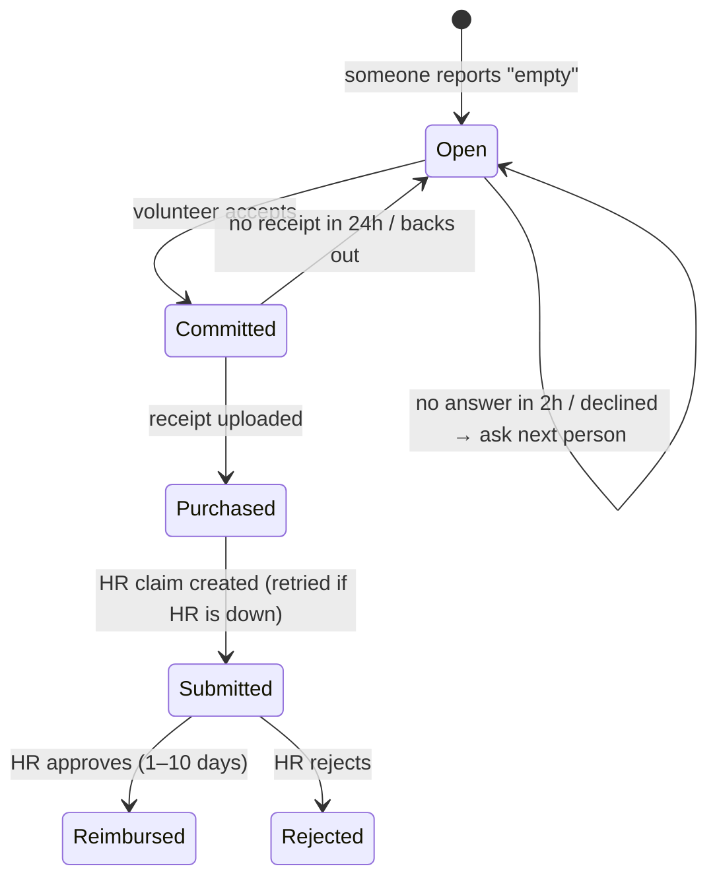

# Snack Counter Automation

## The idea

The shopping isn't what's broken. The coordination around it is. All four problems in the brief come
from nobody being asked personally, nobody knowing someone is already on it, and nothing being recorded.
So people still buy and refill by hand, and a **chat bot** handles everything around that:

- It turns "the box is empty" into **one** task for that office.
- It **asks one volunteer by name**.
- It tells the office who's buying.
- It tells the buyer how much they can spend.
- It files the HR claim the moment the receipt arrives.
- It moves on when someone goes quiet.

It lives in chat because everyone is already there.

I considered three alternatives. A fixed rota breaks with hybrid work and holidays, because the person on
duty often isn't in the office. "Post to everyone, first wins" is roughly today's process, with the same
bystander effect. A company card per office would remove reimbursement entirely, and **it's the first thing
I'd ask about**. I assumed it isn't available, because the brief describes the HR flow.

## From "empty" to "reimbursed"

1. **Open.** Anyone says the box is empty. If a refill is already running for that office, the bot says so and pings nobody.
2. **Offer.** The bot DMs one volunteer, who has 2h to answer. A decline or silence moves it to the next person. If nobody suitable is left, the office channel is asked and anyone in the office can take it.
3. **Committed.** Exactly one person can accept. They get a spending limit and 24h. The channel sees "Lars is refilling, please don't buy".
4. **Purchased → Submitted.** The receipt (photo, amount, optional items) is checked and the claim goes straight to HR in the receipt's currency, under the buyer's employee ID. HR pays out in their payroll currency. Once someone has paid, the refill is never taken from them.
5. **Reimbursed / Rejected.** The bot checks HR and tells the buyer.

**Who gets asked.** Volunteers from *either* office who are physically in this office today, haven't been
asked for this refill, and aren't already buying for another one. The pick is whoever has done the fewest
refills in 90 days, then whoever's last refill was longest ago. People still waiting for their money are
asked last. That's a soft rule, because an empty box is worse. "In the office today" covers hybrid work,
holidays and visitors with one rule.

**Budget.** Each office's budget stays in its own currency (6 000 NOK, 15 000 INR).
- **Limit:** the smaller of the largest normal purchase and what's left this month. It's shown *before* buying.
- **Refused receipts:** over the limit, the wrong currency, zero or negative, or no photo.
- **Budget used up:** no refill opens and the channel is told.
- **Rejected claims:** the money goes back to the budget.
- **Which month:** the office's local month when the refill opened. Late on 31 Jan UTC, Bengaluru is already in February.

A visitor's purchase counts against the office they bought for. The only currency conversion is the
report's grand total, at a monthly rate from finance.

## Main parts and their data

| Part | Data it keeps |
|---|---|
| **Refill service** (all the rules) | Per refill: office, budget month, state, who's been asked, buyer, deadlines, spending limit, amount, items, HR claim ID |
| **Office settings** | Currency, monthly budget, largest normal purchase, time zone |
| **"Who's in today"** | Nothing. Reads calendar or chat presence (simulated) |
| **Chat and HR adapters** | Nothing. HR owns the claims |
| **Scheduler** | Nothing. Runs every few minutes: timeouts, HR retries, status checks |

Money is stored as whole øre or paise, always next to its currency.

## How each problem is prevented

| Problem | Prevention |
|---|---|
| Box empty for days | A named person is always asked. Timeouts move it on. Channel fallback when nobody's available |
| Two people buy | One refill per office. Only one person can accept. The channel is told who's buying. A replaced buyer is told "don't buy" and their receipt is refused |
| Same people, slow money | Fewest-refills-first rotation. People who are owed money go last. Claims filed instantly. Receipts survive an HR outage |
| No visibility | Every purchase recorded with items. One monthly report: spend per office, who refilled, what was bought, total in NOK |

## Trade-offs

- **One person at a time** is slower in the worst case (2h each). But personal asks get answered and group asks get ignored, and the channel fallback limits the downside.
- **A hard spending limit** protects the budget. A small overspend needs a person to sort it out. I'd see how often that happens before building for it.
- **I check HR for status** rather than waiting to be notified, so it works with whatever HR offers.
- **A retried claim could rarely duplicate** if HR's reply is lost. The refill ID in the description lets HR spot it. I'd use an idempotency key if HR has one.
- **In memory, one lock.** Fine for a prototype with 35 people. A real version keeps the same rules on a database.

## Deliberately not built

- **Sensors in the box.** Costly for a signal people already give in one message.
- **Inventory tracking.** Receipt items already answer "what gets bought".
- **Approval before buying.** The spending limit does that job without the wait.
- **Live exchange rates.** Finance owns the monthly rate, and reports should be reproducible.
- **A separate employee app.** Everyone is in chat. The web UI in this repo is only for demoing.
- **Leaderboards or "do your share" nags.** The rotation handles fairness quietly.
